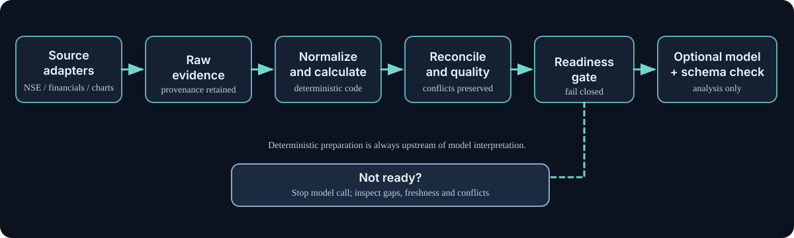
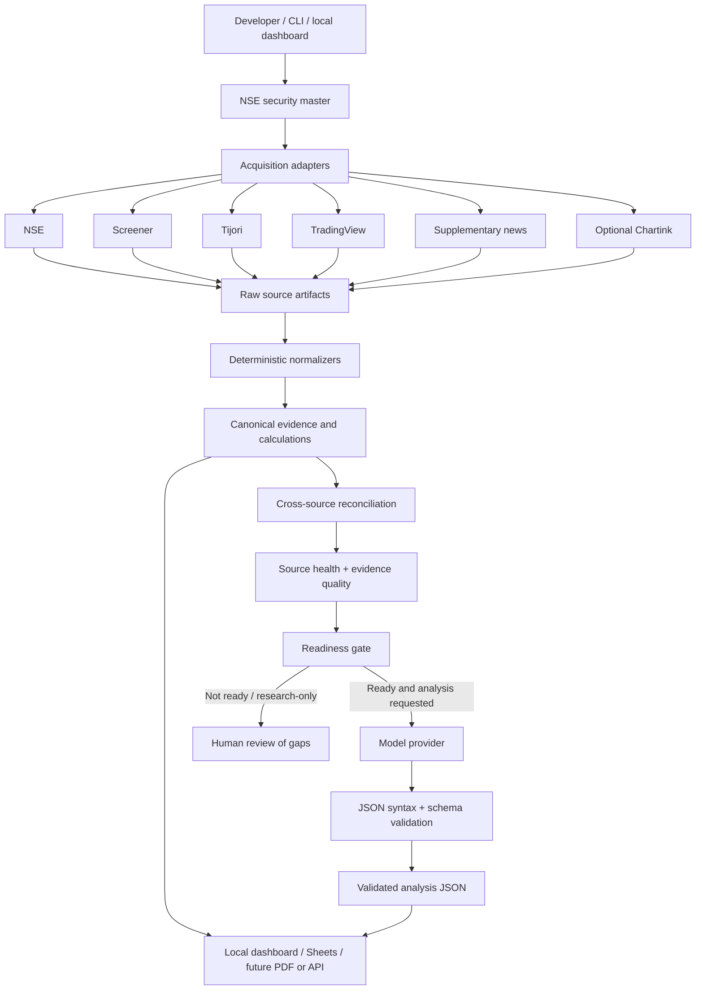
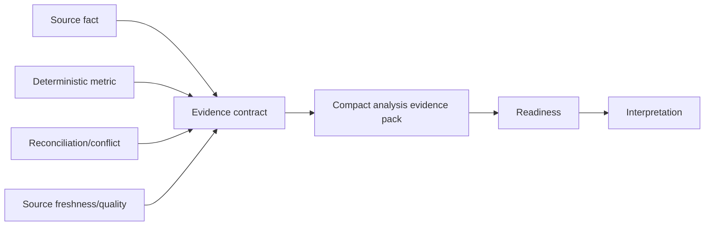

# Architecture

## Design intent

The deterministic pipeline owns data collection, normalization, reconciliation, calculations, quality checks and readiness. Models interpret a bounded evidence package only after the readiness gate passes and analysis is explicitly requested.

## System context

## Stage boundaries

| Stage | Responsibility | Must not do |
|---|---|---|
| Source adapter | Acquire source-specific evidence and metadata | Invent missing values or suppress provider failures |
| Raw evidence | Preserve response/document/screenshot and retrieval context | Be silently rewritten by the model |
| Normalization | Produce stable fields, units and reporting periods | Treat interpretation as a source fact |
| Reconciliation | Compare overlapping facts and preserve conflicts | Hide disagreements without a documented rule |
| Quality/readiness | Gate analysis and report missing or actionable evidence | Make a blocked run ready because a prompt asks |
| Model provider | Generate interpretation from supplied prompts/evidence | Acquire facts behind the deterministic layer or change readiness |
| Schema validator | Reject outputs outside the analysis contract | Accept prose as equivalent to a valid structured result |
| Publishing surface | Present local artifacts for review | Become the canonical source or invalidate local research on failure |

## Evidence layers

## Main paths and contracts

- `src/index.ts`: CLI orchestration.
- `src/adapters/`: source-specific acquisition.
- `src/lib/individual-stock-evidence.ts`: normalized facts and reconciliation.
- `src/lib/analysis-evidence-pack.ts`: compact handoff.
- `src/lib/analysis-readiness.ts`: model boundary.
- `src/lib/model-provider.ts`: provider-neutral generation contract (when present in the current base/PR).
- `src/schema.ts`: final analysis schema.
- `research/<SYMBOL>/manifest.json`: run and artifact index.
- `research/<SYMBOL>/normalized/`: deterministic derived artifacts.
- `outputs/`: generated analysis and agent audit output.

## Runtime and publishing

The local filesystem is the canonical research store. Google Sheets is an optional published view; the code being present does not prove the Apps Script receiver is deployed or that images appear in the workbook. A publishing failure should leave local artifacts intact.

## Version/source links

- [Main repository](https://github.com/luckyhegde6/stockResearchApp)
- [Architecture overview in repository](https://github.com/luckyhegde6/stockResearchApp/blob/main/docs/ARCHITECTURE.md)
- [Agent operating contract](https://github.com/luckyhegde6/stockResearchApp/blob/main/AGENTS.md)
- [PRD-004](https://github.com/luckyhegde6/stockResearchApp/blob/main/docs/prd/004-evidence-first-research-platform.md)
- [Architecture decisions](https://github.com/luckyhegde6/stockResearchApp/blob/main/DECISIONS.md)
