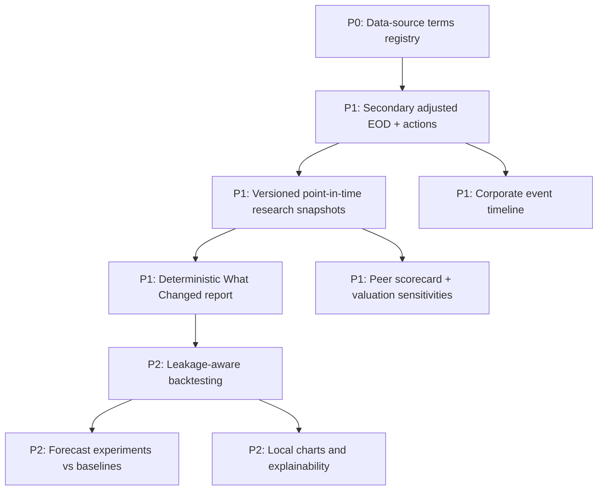

# Data Sources and Feature Roadmap

## Current source roles

| Source | Intended role | Evidence types | Policy notes |
|---|---|---|---|
| NSE | Core/primary | Quote/history, exchange disclosures, security master | Respect public access rules and data-use/redistribution terms |
| Screener.in | Core financials | Financial statements, ratios, company info, available filings/calls | Page structure and availability can vary |
| Tijori | Complementary financial/operational context | Industry, operating metrics, financial context | Preserve extraction time and source page |
| TradingView | Chart and public-page evidence | Market charts, indicators/page surfaces/screenshots | Screenshots are visual evidence; avoid using pixels as numeric truth |
| News adapters | Supplementary | Headlines, publisher URL and timestamps | Headline sentiment is not official confirmation |
| Chartink | Optional screening | Screening scans and conditions | Kept optional for individual-stock research |
| BSE | Excluded from production individual-stock hierarchy | — | Change only through a reviewed source-policy decision |

## Proposed free-data enrichment

The first candidates to evaluate are:

1. **TejHQ / tej-bazaar / tej-api** — documented end-of-day OHLCV, exchange/date snapshots and corporate actions; adjusted prices and symbol history are documented in the free-key tier.
2. **NSE announcements** — primary disclosure URLs and source timestamps for corporate events, subject to current usage terms.
3. **Issuer investor-relations pages** — official annual reports, results, presentations and other company material.
4. **Google News RSS/public article pages** — supplementary discovery; confirm important events against issuer/exchange sources.
5. **yfinance/Yahoo Finance** — optional research-only diagnostic pending terms review; do not assume commercial redistribution permission.

“Free to access” is not equal to “free to use for commercial purposes” or “redistributable.” Open-source fetching code is not the same as a license for the underlying market data. The [full source evaluation](https://github.com/luckyhegde6/stockResearchApp/blob/main/docs/wiki/Free-Research-Data-Sources.md) links the providers and terms.

## Proposed features, ranked

### 1. Source terms and health registry (P0)

Every provider declares role, endpoint/data class, authentication, free/paid tier, quota, freshness target, terms/license URL, allowed use, feature flag and last review date. Distinguish unavailable, not configured, rate limited and stale.

### 2. Corporate-action-aware EOD bars (P1)

Keep the new source secondary and opt-in. Store original response bytes/checksum, URL, provider, retrieval time and normalization version. Check OHLC invariants, trading days, duplicate bars, invalid prices and adjustment methodology. Never overwrite primary evidence.

### 3. “What Changed?” (P1)

Compare two completed runs using comparable period, currency, units, reporting scope and adjustment basis. Emit added/removed/changed facts, source-freshness changes, data quality changes and evidence references. Numeric differences must be deterministic; model text may summarize them but does not compute the source values.

### 4. Corporate-event timeline (P1)

Store event type, announcement time, effective date only when sourced, source URL, artifact ID, and confirmation state. Keep source facts separate from model-inferred materiality. Deduplicate issuer/exchange reposts.

### 5. Peer scorecard and valuation sensitivity (P1)

Expose formulas and sourced inputs for growth, profitability/cash conversion, leverage, valuation, momentum/liquidity and data quality. Flag unmatched periods, standalone/consolidated differences, incomplete peers and assumption-driven results.

### 6. Backtesting before prediction (P2)

Support point-in-time data, market calendar, costs/slippage, corporate actions, position sizing, drawdown, benchmarks, out-of-sample splits, survivorship-bias checks and leakage tests. Compare any forecast model to simple baselines before use.

## Acceptance gates for any new source

- Terms and permitted use reviewed and recorded.
- Fixture tests for normal, empty, malformed, stale, duplicated and outage responses.
- Source values retain URL and retrieval/as-of metadata.
- Parity checks compare compatible fields and periods.
- Conflicts appear in reports; source hierarchy does not silently change.
- Provider failure cannot turn a blocked research run into a ready one.

## References

- [TejHQ API docs](https://tejhq.dev/docs)
- [TejHQ open source pipeline](https://github.com/tejhq/tej-bazaar)
- [NSE corporate filings](https://www.nseindia.com/companies-listing/corporate-filings-announcements)
- [NSE data policy](https://www.nseindia.com/static/market-data/nse-data-policy)
- [Issuer-specific investor-relations pages](https://www.nseindia.com/companies-listing/corporate-filings-announcements)
- [yfinance project and terms caveat](https://github.com/ranaroussi/yfinance)
