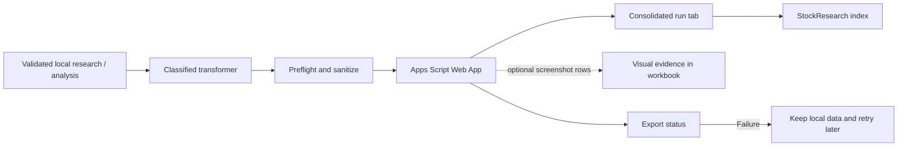

# Google Sheets Publishing

## Role of the workbook

The local filesystem is canonical. Google Sheets is a downstream, optional publication and reading surface. A failed export must not invalidate local research artifacts or allow incomplete evidence to pass readiness.

[Open the StockResearch workbook](https://docs.google.com/spreadsheets/d/1YMKesB9CBnntEnLp-rznzuOOixWDwX6WaWqb-FmtRak/edit?gid=0#gid=0)

## Publishing flow



One research or analysis run should result in one consolidated data tab with labelled sections; `StockResearch` remains the clickable run index. Command audit records stay local.

## Setup

1. Deploy the current `integrations/google-sheets/Code.gs` as a new Apps Script Web App version.
2. Configure script properties `SHEET_ID` and `API_TOKEN`.
3. Configure local `.env` values:
   - `GOOGLE_SHEETS_WEBHOOK_URL`
   - `GOOGLE_SHEETS_WEBHOOK_TOKEN`
   - `GOOGLE_SHEETS_ID`
4. Run the doctor:
   ```powershell
   npm run sheets:doctor
   ```
5. Publish an existing research run:
   ```powershell
   npm run sheets:export -- research ITC
   npm run sheets:export -- analysis ITC
   ```
6. Inspect the real workbook: verify index/tab creation, field mapping, links and screenshot objects.

A green test suite verifies source code, not the deployment. Do not mark image insertion complete until it is visibly verified in the workbook.

## Image and path rules

- Screenshots are supporting visual evidence, not numeric truth.
- The exporter optimizes images before sending them; the Apps Script receiver performs its own size validation.
- A row must record an explicit skip/failure reason when an image is not embedded.
- Never publish local filesystem paths, private browser state, or credentials.
- Keep `value`, `status` and `embedding_status` consistent.

## Troubleshooting

| Symptom | First checks |
|---|---|
| Doctor fails | Endpoint, token and deployed service version |
| Workbook unchanged | Confirm current Apps Script deployment and spreadsheet ID |
| Image missing | Inspect export report, image limits and receiver logs/status |
| Empty evidence section | Inspect evidence pack and canonical values |
| Local data is good but export failed | Retry export; don't repeat source acquisition without a reason |

## References

- [Integration guide](https://github.com/luckyhegde6/stockResearchApp/tree/main/integrations/google-sheets)
- [Repository setup guide](https://github.com/luckyhegde6/stockResearchApp/blob/main/docs/wiki/Google-Sheets-Setup.md)
- [Publishing rollout plan](https://github.com/luckyhegde6/stockResearchApp/blob/main/docs/GOOGLE_SHEETS_PUBLISHING_PLAN.md)
