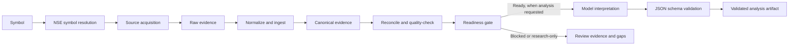

# StockResearchApp


**Research every stock. Understand every change. Defend every decision.**

StockResearchApp is an NSE-first Indian-equity research pipeline. It collects source evidence, preserves raw artifacts, normalizes and reconciles values, evaluates readiness, and optionally invokes a model for final interpretation. The project is research decision support—not a broker, order system, or guarantee of returns.

## Start here

- [Architecture](Architecture)
- [Research workflow](Research-Workflow)
- [Evidence model and guardrails](Evidence-Model-and-Guardrails)
- [Data sources and feature roadmap](Data-Sources-and-Features)
- [Product roadmap and PRDs](Product-Roadmap-and-PRDs)
- [Google Sheets publishing](Google-Sheets-Publishing)
- [Operations and troubleshooting](Operations-and-Troubleshooting)
- [Developer setup and contribution](Developer-Setup)
- [References and glossary](References)

## System overview




## Current implementation status

| Area | Status |
|---|---|
| Deterministic research and evidence preparation | Implemented |
| Readiness, provenance and evidence auditing | Implemented in core pipeline; dashboard trust UX remains planned |
| Read-only agent harness | Initial implementation merged in PR #7 |
| Vendor-neutral model provider | PR #8; check linked PR/CI for latest status |
| Google Sheets exporter | Implemented in code; live deployed workbook/screenshot verification must be checked separately |
| Point-in-time research history and “What Changed?” | Planned |
| Event timeline and thesis monitoring | Planned |
| Leakage-aware backtesting | Planned |
| Live trade execution | Not authorized; requires a separate PRD and safety review |

The code repository is the source of truth. Check [the project README](https://github.com/luckyhegde6/stockResearchApp), [TODO.md](https://github.com/luckyhegde6/stockResearchApp/blob/main/TODO.md), [the PRD index](https://github.com/luckyhegde6/stockResearchApp/blob/main/docs/PRD.md), and [the current pull requests](https://github.com/luckyhegde6/stockResearchApp/pulls) before treating a planned feature as delivered.

## Quick start

```powershell
npm ci
npx playwright install chromium
Copy-Item .env.example .env
npm run version:check
npm run typecheck
npm run test:all
npm run research -- ITC
```

Research is deterministic and does not require an LLM. Configure `LLM_ENDPOINT`, `LLM_API_KEY`, and `LLM_MODEL` only when you intend to run analysis:

```powershell
npm run analyze -- ITC
npm run validate -- ITC
```

## Core principles

1. Evidence before interpretation.
2. Preserve source values, retrieval timestamps, URLs and conflicts.
3. Calculations must be deterministic and disclose the method.
4. Missing, stale or conflicting data must remain visible.
5. Model output is untrusted until validated.
6. Readiness cannot be bypassed by a prompt or agent.
7. Screenshots are visual evidence, not numeric truth.
8. No live execution without a separate approved execution design.

## Useful project links

- [Source repository](https://github.com/luckyhegde6/stockResearchApp)
- [Issues](https://github.com/luckyhegde6/stockResearchApp/issues)
- [Pull requests](https://github.com/luckyhegde6/stockResearchApp/pulls)
- [Product requirements](https://github.com/luckyhegde6/stockResearchApp/tree/main/docs/prd)
- [Architecture decisions](https://github.com/luckyhegde6/stockResearchApp/blob/main/DECISIONS.md)
- [Google Sheets workbook](https://docs.google.com/spreadsheets/d/1YMKesB9CBnntEnLp-rznzuOOixWDwX6WaWqb-FmtRak/edit?gid=0#gid=0)

