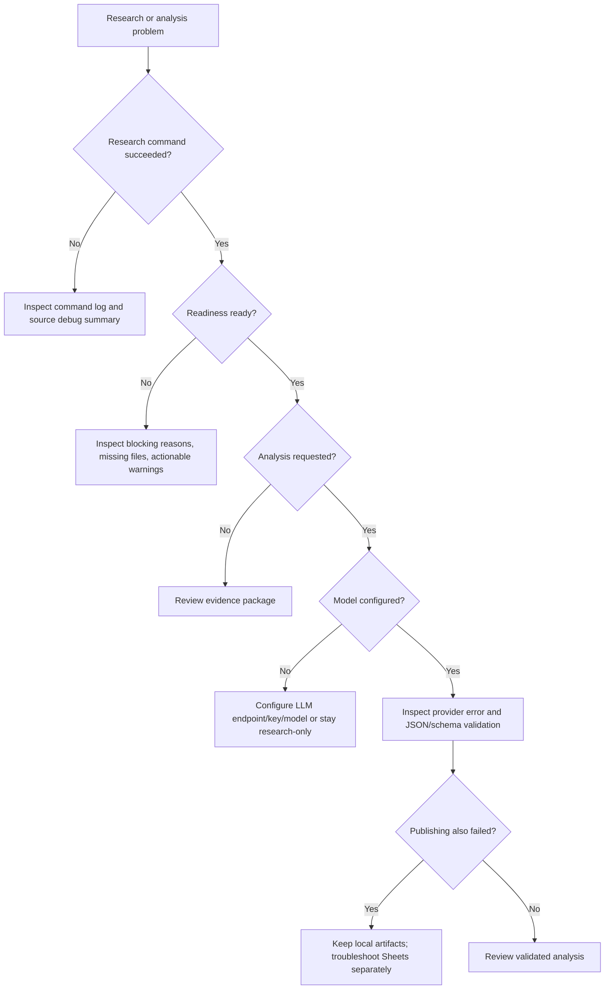

# Operations and Troubleshooting

## Daily commands

```powershell
npm run version:check
npm run typecheck
npm run test:all

npm run research -- ITC
npm run test:analysis-readiness -- ITC
npm run agents:inspect -- ITC
npm run analyze -- ITC
npm run validate -- ITC

npm run sheets:doctor
npm run sheets:export -- research ITC
```

Use only commands present in the current `package.json`; the CLI reference should stay synchronized with scripts.

## Troubleshooting decision tree



## Common issues

### Analysis is blocked

Read `research/<SYMBOL>/analysis-readiness.json`. Fix missing required artifacts or actionable warnings; don't weaken readiness just to force a verdict.

### Output JSON fails

- Separate malformed JSON from schema-invalid JSON.
- Inspect provider response shape, output truncation and analysis schema errors.
- Do not silently repair source facts based on model output.

### Provider returns HTTP 401/403/429/5xx

- Check endpoint/model/key and account quota.
- Respect provider rate limits and timeout settings.
- Never paste API keys or authorization headers into issues or logs.

### Google Sheets does not update

- Run `npm run sheets:doctor`.
- Confirm Apps Script version, URL, token and spreadsheet ID.
- Use manual export to retry an existing artifact.
- A healthy local artifact remains canonical if the export fails.

### Missing or conflicting values

Check source artifact, as-of time, fiscal period, standalone/consolidated scope, units, currency and metric definition. Preserve unresolved conflicts and explain the effect on confidence.

## Safe bug report checklist

Include the command, Node version, symbol (if appropriate), redacted error, affected artifact path, readiness report and relevant source summary. Do not attach `.env`, access tokens, cookies, private Playwright state, or unredacted machine paths.

## Recovery principle

Fix the failed layer instead of restarting everything. A publishing problem should normally trigger an export retry, not a new multi-minute acquisition run.
