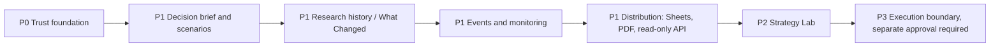

# Product Roadmap and PRDs

## Status semantics

- **Implemented:** code and regression tests exist.
- **In progress:** active implementation or meaningful partial coverage.
- **Planned:** backlog/PRD only.
- **Operational verification pending:** code exists but an external deployment or live integration has not been verified.
- **Blocked/gated:** requires explicit policy or safety review before development.

## Roadmap

| Release | Scope | Current status | Exit gate |
|---|---|---|---|
| 1. Trust layer | Agent contracts, readiness explanations, provenance drilldown | Partially implemented | Agents cannot bypass readiness; material claims have traceable evidence |
| 2. Decision layer | Brief, scenarios, counter-thesis, risks/catalysts and sensitivity | Planned | Assumptions and formulas explicit; limitations visible |
| 3. Research history | Comparable run diffs and a timeline | Planned | Incompatible periods/scopes are rejected or clearly flagged |
| 4. Monitoring | Watchlists, thesis conditions and source-linked alerts | Planned | Deduplicated, freshness-aware, confirmed/unconfirmed status retained |
| 5. Distribution | Reliable Sheets, PDF and read-only Research API | Partially implemented | Deployment verified; retries idempotent; local research survives export failure |
| 6. Strategy Lab | Strategy specs, point-in-time backtests and forecasting experiments | Planned | Leakage-tested, cost-aware, out-of-sample and reproducible |
| 7. Execution boundary | Potential paper-trading only after separate safety design | Gated/not authorized | Separate PRD, kill switch, risk limits, credentials and human authorization |

## Current status snapshot

- The deterministic evidence and readiness path is implemented.
- PR #7 merged the initial read-only agent harness and evidence audit.
- PR #8 is the model-provider boundary and documentation/roadmap update. Check the live PR and CI before relying on a status copied into another page.
- Google Sheets publishing code and dashboard status surfaces exist; deployed Apps Script and visible image insertion require live verification.
- PRD-004 is an active roadmap with requirements still open.
- PRD-005 (free data enrichment and point-in-time research history) is proposed/discovery-ready, not implemented.

## Next implementation order

1. Complete model-provider boundary review.
2. Test agent schema/policy failures and redacted audit metadata.
3. Add source registry with terms/quota/allowed-use policy.
4. Add opt-in secondary adjusted EOD/corporate-actions adapter.
5. Add versioned research snapshots and deterministic “What Changed?”.
6. Add source-linked corporate-event timeline.
7. Add peer scorecard and valuation sensitivities.
8. Add leakage-aware backtesting.
9. Evaluate forecast models against simple baselines.
10. Keep live execution out of scope without an independently reviewed PRD.

## Authoritative product docs

- [PRD index](https://github.com/luckyhegde6/stockResearchApp/blob/main/docs/PRD.md)
- [PRD-004](https://github.com/luckyhegde6/stockResearchApp/blob/main/docs/prd/004-evidence-first-research-platform.md)
- [PRD-005](https://github.com/luckyhegde6/stockResearchApp/blob/main/docs/prd/005-free-data-and-research-history.md)
- [Prioritized TODO](https://github.com/luckyhegde6/stockResearchApp/blob/main/TODO.md)
- [Architecture decisions](https://github.com/luckyhegde6/stockResearchApp/blob/main/DECISIONS.md)
- [Changelog](https://github.com/luckyhegde6/stockResearchApp/blob/main/CHANGELOG.md)
