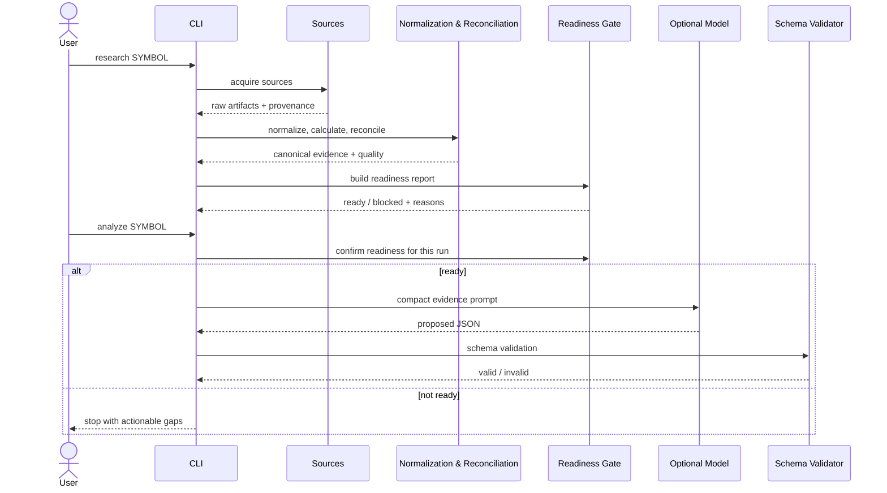

# Research Workflow

## Standard deterministic run

```powershell
npm run research -- ITC
```

A normal run resolves the NSE security, collects configured evidence, preserves raw artifacts, normalizes data, calculates supported technical indicators, reconciles overlapping values and writes quality/readiness artifacts. It does not need an LLM.

## Optional final analysis

```powershell
npm run analyze -- ITC
npm run validate -- ITC
```

Analysis reruns the deterministic pipeline, checks readiness, invokes the configured OpenAI-compatible model provider only if ready, validates JSON syntax, and validates the result against `src/schema.ts`. A missing LLM configuration should not prevent deterministic research.

## Flow diagram



## Artifacts to inspect first

For a run under `research/ITC/`, start with:

1. `manifest.json`
2. `analysis-readiness.json`
3. `normalized/analysis-evidence-pack.json`
4. `normalized/analysis-inputs.json`
5. `normalized/reconciliation.json`
6. `source-health.json`
7. `evidence-quality.json`
8. `evidence-contract.json`
9. `analysis-prompt.txt` (for analysis handoff review)

Read raw PDFs, HTML or screenshots when checking provenance or investigating a missing/conflicting detail, not as the default context.

## Readiness outcomes

- **Ready:** required evidence/quality conditions pass. This permits, but does not itself trigger, an explicitly requested analysis.
- **Blocked:** required files, evidence completeness or actionable-warning rules prevent analysis. Follow the listed reasons.
- **Partial override:** only use the explicitly configured override in controlled research experiments; record it and never present partial evidence as complete.

A complete-looking dashboard or spreadsheet is not proof that a run is ready.

## Troubleshooting quick commands

```powershell
npm run test:analysis-readiness -- ITC
npm run agents:inspect -- ITC
npm run agents:audit -- ITC
npm run test:all
```

Use `npm run agents:inspect -- SYMBOL` or the actual command documented by `package.json` for the current branch; keep CLI docs synchronized with the code.

## References

- [Onboarding](https://github.com/luckyhegde6/stockResearchApp/blob/main/docs/ONBOARDING.md)
- [CLI reference](https://github.com/luckyhegde6/stockResearchApp/blob/main/docs/CLI_REFERENCE.md)
- [Testing & quality](https://github.com/luckyhegde6/stockResearchApp/blob/main/docs/TESTING_AND_QUALITY.md)
- [Evidence contract](https://github.com/luckyhegde6/stockResearchApp/blob/main/docs/EVIDENCE_CONTRACT.md)
